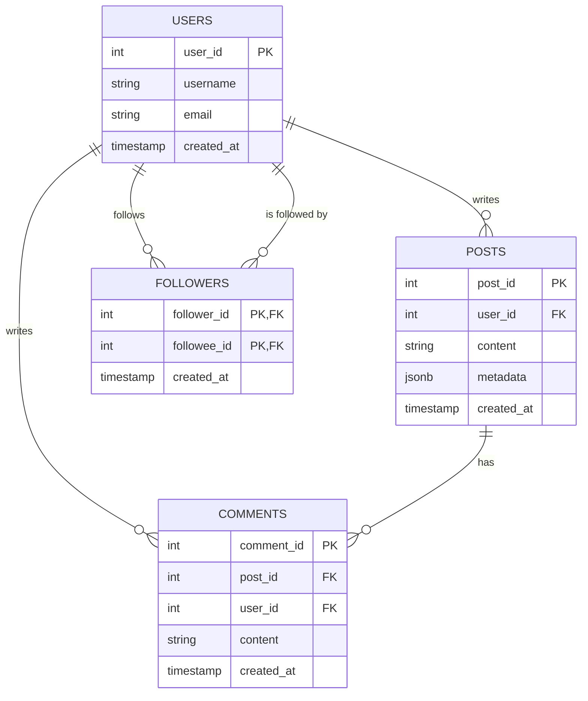

# Social Media Platform Data Backend

The data backend for a simple social media app. Users can write posts, comment on posts, and follow each other.

## Tech Stack

- **PostgreSQL**: main database (users, posts, comments, followers)
- **Python** with `psycopg2`: scripts that talk to the database
- **Redis**: caching user timelines
- **MongoDB**: activity logs (likes, follows, ...)

## Database Design



## Project Structure

```
social-media-backend/
├── docs/
│   └── er_diagram.md   # ER diagram of the database
├── .gitignore
└── README.md
```

## Getting Started

1. Clone the repository and open the folder.
2. Create a virtual environment:
   ```
   python -m venv .venv
   ```
3. Activate it (Windows):
   ```
   .venv\Scripts\activate
   ```

## Progress

- [ ] Day 1: Database schema design and setup
- [ ] Day 2: Core user actions with Python transactions
- [ ] Day 3: Redis caching and MongoDB logging
- [ ] Day 4: Feed query building and optimization
