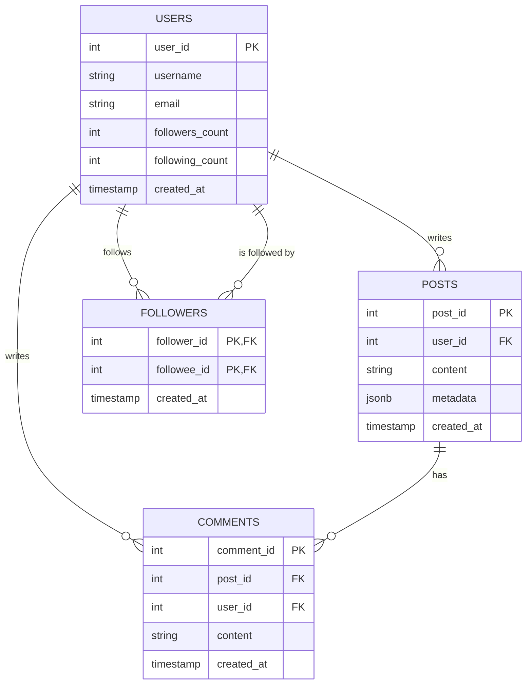

# Social Media Platform Data Backend

The data backend for a simple social media app. Users can write posts, comment on posts, and follow each other.

## Tech Stack

- **PostgreSQL**: main database (users, posts, comments, followers)
- **Python** with `psycopg2`: scripts that talk to the database
- **Redis**: caching user timelines
- **MongoDB**: activity logs (likes, follows, ...)

## Database Design



## Project Structure

```
social-media-backend/
├── db/
│   ├── schema.sql      # creates the 4 tables
│   └── test_data.sql   # a few sample rows
├── docs/
│   └── er_diagram.md   # ER diagram of the database
├── database.py         # PostgreSQL pool + Redis and MongoDB connections
├── actions.py          # user actions: create user/post, comment, follow, like
├── feed.py             # user timelines, cached in Redis
├── activity.py         # activity logs in MongoDB
├── requirements.txt    # Python packages
├── .env                # your database password (not in git)
├── .gitignore
└── README.md
```

## Getting Started

1. Clone the repository and open the folder. Make sure PostgreSQL, Redis (on Windows: Memurai)
   and MongoDB are installed and running on their default ports (5432, 6379, 27017).
2. Create a virtual environment:
   ```
   python -m venv .venv
   ```
3. Activate it (Windows):
   ```
   .venv\Scripts\activate
   ```
4. Install the Python packages:
   ```
   pip install -r requirements.txt
   ```
5. Create a `.env` file in the project folder with your PostgreSQL password:
   ```
   DB_PASSWORD=your_password_here
   ```
6. Create the database (inside `psql -U postgres`):
   ```sql
   CREATE DATABASE social_media;
   ```
7. Create the tables, then add the sample data:
   ```
   psql -U postgres -d social_media -f db/schema.sql
   psql -U postgres -d social_media -f db/test_data.sql
   ```

## Usage

The functions in `actions.py` can be called from Python:

```python
from actions import create_user, create_post, add_comment, follow_user, unfollow_user, like_post
from activity import get_user_activity
from feed import get_cached_timeline

user_id = create_user("yaw", "yaw@mail.com")
post_id = create_post(user_id, "My first post!", {"tags": ["intro"], "location": "Accra"})
add_comment(post_id, 1, "Welcome!")
follow_user(user_id, 1)     # yaw follows user 1
like_post(user_id, 1)       # yaw likes post 1

print(get_cached_timeline(user_id))   # posts from people yaw follows, newest first
print(get_user_activity(user_id))     # yaw's activity log, newest first

unfollow_user(user_id, 1)   # yaw stops following user 1
```

### PostgreSQL

- Every query uses parameters (`%s`), never string formatting, to prevent SQL injection.
- Connections come from a pool (`database.py`) and are always returned, even after an error.
- `follow_user` and `unfollow_user` are **transactional**: the follow row and both users' counts
  are updated together in one transaction. If any step fails, everything is rolled back.
- Post metadata (tags, location) is stored as `JSONB`.

### Redis: timeline cache

- `get_cached_timeline(user_id)` first looks for the key `timeline:<user_id>` in Redis.
  If it is there, it is returned straight away. If not, the timeline is built from PostgreSQL
  and saved in Redis for 60 seconds.
- The cache is deleted as soon as it goes out of date:
  - a new post deletes the cached timelines of the author's followers
  - a follow or unfollow deletes the follower's cached timeline
- The 60-second expiry is a safety net, so a timeline is never stale for long.

### MongoDB: activity logs

- Every successful action (signup, post, comment, follow, unfollow, like) adds one document to
  the `activity_logs` collection, for example:
  ```json
  {"user_id": 3, "action": "follow", "details": {"followee_id": 1}, "created_at": "..."}
  ```
- Likes are only stored here, as activities.
- `get_user_activity(user_id)` returns a user's newest activities.

## Progress

- [x] Day 1: Database schema design and setup
- [x] Day 2: Core user actions with Python transactions
- [x] Day 3: Redis caching and MongoDB logging
- [ ] Day 4: Feed query building and optimization
